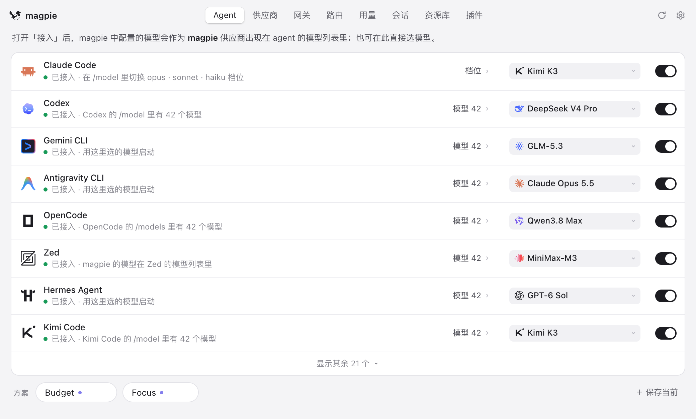
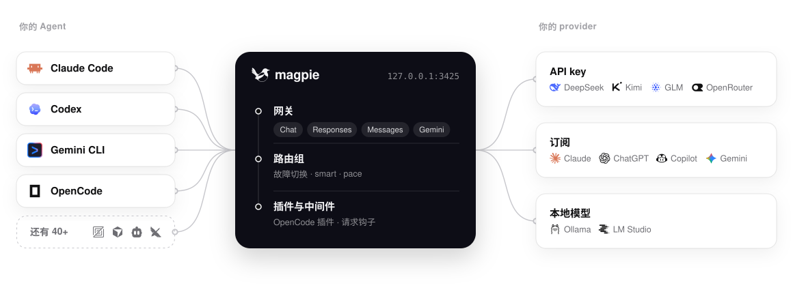

<div align="center">

<a href="https://useEcho.ai/zh/"></a>

# Echo

> **Echo 就是用 MyGo 重构的 magpie。** 本项目是基于 [magpie](https://usemagpie.ai)
> 的 MyGo 重构：网关、供应商和 Agent 都还在，桌面外壳换成了原生 UI，
> 部分功能做了简化或优化。

### 所有 Agent 的模型，一处搞定。

**Claude Code 跑 Kimi，Codex 跑 DeepSeek，Gemini CLI 跑 GLM，OpenCode 用你的 ChatGPT 订阅。**<br>
在菜单栏一点就能切换。所有 Agent 共用一个本地网关，<br>
额度用完时，它会悄悄切到下一个账号。

<!-- [](https://github.com/yetone/Echo-releases/releases/latest) [](https://github.com/yetone/Echo/stargazers) [](https://discord.gg/vGSnD3ZKQF) [](LICENSE)<br>
     -->
<!-- 
<sub>赞助商</sub><br> -->
<!-- <a href="https://useEcho.ai/go/apinebula/readme"><picture><source media="(prefers-color-scheme: dark)" srcset="site/public/img/sponsor-apinebula-dark.svg"></picture></a>
<a href="https://useEcho.ai/go/zerotoken/readme"><picture><source media="(prefers-color-scheme: dark)" srcset="site/public/img/sponsor-zerotoken-dark.svg"></picture></a> -->

<!-- **[下载](https://useEcho.ai/zh/)** &nbsp;·&nbsp; **[文档](https://useEcho.ai/docs/start)** &nbsp;·&nbsp; **[完整参考（英文）](docs/reference.md)** &nbsp;·&nbsp; **[插件](https://github.com/Echo-community/plugins)** &nbsp;·&nbsp; **[Discord](https://discord.gg/vGSnD3ZKQF)** &nbsp;·&nbsp; [English](README.md) · **简体中文** -->

<br>

<picture>
  <source media="(prefers-color-scheme: dark)" srcset="site/public/img/agents-zh-dark.png">
  
</picture>

</div>

<br>

## 下载与安装

**macOS 13+**：从 [GitHub Releases](https://github.com/aohun/Echo/releases/latest) 下载 Apple 芯片的 arm64 DMG，或 Intel Mac 的 x86_64 DMG。

**Windows x64**：从 [GitHub Releases](https://github.com/aohun/Echo/releases/latest) 下载 Windows 的 .exe 安装包。

**Homebrew** 是 macOS 上推荐的安装与升级方式：

```sh
brew tap aohun/echo https://github.com/aohun/Echo.git
brew install --cask aohun/echo/echo
brew upgrade --cask aohun/echo/echo
```

### 如果 macOS 说打不开 Echo.app

如果 macOS 说「Apple 无法验证『Echo』是否包含可能危害 Mac 安全或泄露隐私的恶意软件」，说明手动下载的安装包可能还没有经过 Apple 的公证。先确认这个 app 来自可信的 [GitHub Releases](https://github.com/aohun/Echo/releases/latest)，再用下面任一方法：

1. 在**应用程序**里按住 Control 点击 `Echo.app`，选**打开**，在确认对话框里再选一次**打开**。
2. 如果 macOS 还是拦着，打开**系统设置 > 隐私与安全性**，在安全警告旁点**仍要打开**，然后再启动这个 app。
3. 也可以在终端里去掉隔离属性：

   ```sh
   sudo xattr -dr com.apple.quarantine /Applications/Echo.app
   ```

这些步骤只用于你信任来源的 app。用 Homebrew 安装的通常不需要手动去掉隔离属性。

## Echo 适合你吗？

每个 Agent 都把模型写在自己的配置文件里，格式各不相同，key 和 base URL 各管各的。花钱买的订阅只能在一个 Agent 里用。Echo 把这些收进一个应用和一个本地网关：

- **任意 Agent 用任意模型**，在一张表里选。Echo 只改 Agent 配置里该改的那一个键。
- **一个 provider 处处能用**：API key、本地模型，或者你登录着的 Claude、ChatGPT、Copilot、Gemini、Grok 订阅。
- **额度用完也不断**：路由组自动切到下一个账号或模型，Agent 看不到报错。

如果你用不止一个 Agent、不止一个 provider 或不止一个账号，它就适合你。如果你只用一个 Agent、只用它自家的订阅，而且够用，那就不需要 Echo。
<!-- 
支持 macOS、Windows 和 Linux（菜单栏应用、窗口、TUI、Web 界面和 CLI），也能跑在 Docker 和 Termux 上。 -->

<!-- ## 快速开始

**1 · 安装**。从 **[useEcho.ai](https://useEcho.ai/zh/)** 下载应用，或者运行：

```sh
curl -fsSL https://useEcho.ai/install.sh | sh
```

<sub>Mac 版已签名并公证，每个版本都会自动更新。网络受限时可用 `--proxy` 或 `--mirror`。也可以 `go install github.com/yetone/Echo@latest`，或者用 [Docker 镜像](https://useEcho.ai/docs/docker)。</sub>

**2 · 添加 provider**。打开 Echo，进入 **Providers → 添加 provider**。选一个预设、粘贴 key，或者登录一个订阅。

**3 · 选模型**。在 **Agents** 页给每个 Agent 选一个模型。开一个新会话就用上了。

也可以全程在终端里操作：

```sh
Echo provider add deepseek sk-…              # 预设只需要 key
Echo claude deepseek/deepseek-v4-pro          # Claude Code 用 DeepSeek
Echo codex moonshot/kimi-k2.5                 # Codex 用 Kimi
Echo group add "Opus anywhere" models=claude/claude-opus-5-5,copilot/claude-opus-5.5 routing=smart
Echo claude group/opus-anywhere               # 在多个订阅间自动切换
Echo save work && Echo use work             # 方案
Echo quota                                    # 每个套餐还剩多少
Echo tui                                      # 全部功能，在终端里
```

Echo 通过读取智能体的登录信息（Claude Code 和 Codex 的文件、钥匙串）找到它们登录的订阅。不想让它读取，可以在 设置 → 隐私 里关闭「订阅账号」，或运行 `Echo accounts discovery off`（`on` 重新开启）。`Echo_NO_ACCOUNTS=1` 只对这一次运行关闭，不改动保存的设置。API Key 服务商不受影响。 -->

## 支持的 Agent

<table>
<tr><td>

Claude Code · Claude Desktop · Claude Science · Codex · Gemini CLI · Antigravity CLI · OpenCode · OpenChamber · MiMo Code · DevEco Code · Pi · oh-my-pi · StepCode · MothX · Aside · OmO · Prime Agent · Goose · Cursor CLI · Cursor Private Inference · Zed · VS Code Chat · VS Code Insiders · VSCodium Chat · JetBrains Air · Copilot (JetBrains) · Copilot CLI · Crush · DeepSeek Harness · Reasonix Studio · Command Code · fx · Devin · Hermes Agent · Mister Morph · Kimi Code · jcode · Qwen Code · Muse Code · Empryo · MiniMax Code · Droid · Cline · Qoder · Qoder CN · Grok Build · Grok App · ZCode · WorkBuddy · WorkBuddy AI · CodeBuddy Code · Pencil · OpenPencil · Raycast · T3 Code · OpenHanako · AtomCode · Snow CLI · Alma · Cindy · Lody · Ante · AstrBot

</td></tr>
</table>

Echo 只显示你电脑上装了的 Agent；部分 Agent 的配置说明见[参考文档](docs/reference.md#notes-on-some-agents)（英文）。其他任何能填 base URL 的工具也都能用这个网关：

```sh
export OPENAI_BASE_URL=http://127.0.0.1:3426/v1     OPENAI_API_KEY=Echo
export ANTHROPIC_BASE_URL=http://127.0.0.1:3426     ANTHROPIC_API_KEY=Echo
export GOOGLE_GEMINI_BASE_URL=http://127.0.0.1:3426 GEMINI_API_KEY=Echo
```

## 整体结构

`127.0.0.1:3426` 上的网关同时支持 OpenAI Chat、OpenAI Responses、Anthropic Messages 和 Gemini，并在它们之间互相转换，流式输出、工具调用和推理都支持。

<picture>
  <source media="(prefers-color-scheme: dark)" srcset="site/public/img/architecture-zh-dark.svg">
  
</picture>


